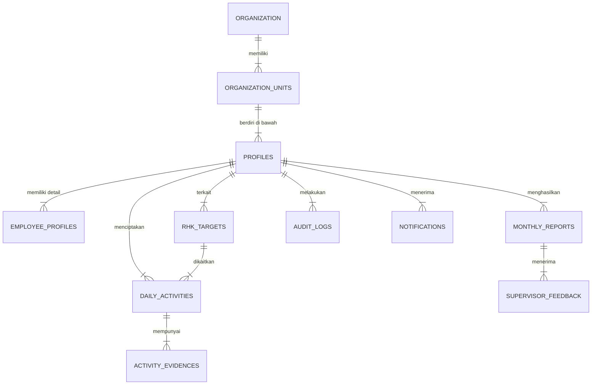
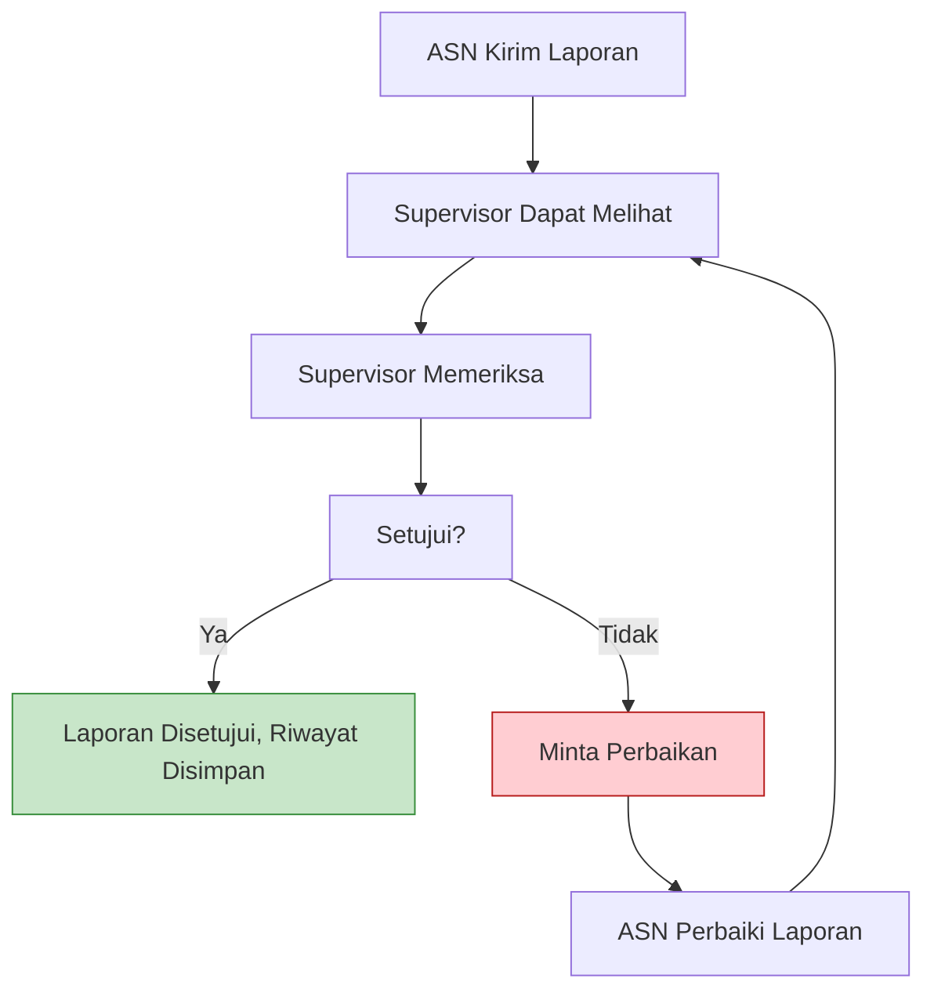

# JEJAK KINERJA AI — Product Requirements Document (PRD)

## 1. Executive Summary

JEJAK KINERJA AI adalah aplikasi web berbantuan AI untuk memudahkan Aparatur Sipil Negara (ASN) mencatat aktivitas pekerjaan harian, mengelola bukti pendukung, memetakan aktivitas terhadap Rencana Hasil Kerja (RHK), serta menghasilkan laporan kinerja bulanan secara otomatis. Aplikasi ini dirancang untuk mengatasi masalah ASN yang sering lupa mencatat aktivitas, dokumentasi tersebar, dan penyusunan laporan manual. Dengan menggunakan teknologi AI untuk memperbaiki narasi dan otomasi pembuatan laporan, serta penyimpanan data terpusat melalui PostgreSQL (Supabase), aplikasi ini menyediakan dashboard bagi ASN dan atasan untuk memantau perkembangan kinerja dalam wadah yang terstruktur. Aplikasi ini dideploy ke Vercel menggunakan free tier dan menggunakan layanan gratis Supabase, mendukung multi-organisasi melalui organisasi_id, dan siap untuk dijalankan secara publik.

---

## 2. Product Overview

| Field | Value |
|---|---|
| **Nama Aplikasi** | JEJAK KINERJA AI |
| **Tagline** | Catat Hari Ini, Buktikan Kinerja, Otomatis Jadi Laporan |
| **Deskripsi** | Aplikasi pencatatan aktivitas kerja harian ASN dengan AI untuk dokumentasi, pemetaan RHK, dan laporan bulanan |
| **Platform** | Web Application Responsive / Mobile First / PWA-ready |
| **Deployment** | Vercel (Hobby tier) |
| **Database** | Supabase PostgreSQL |
| **Bahasa** | Indonesia |
| **Target User** | ASN instansi pemerintah, atasan supervisor, administrator |
| **Prinsip Utama** | Alat bantu dokumentasi, tidak menggantikan e-Kinerja BKN, tidak menetapkan nilai otomatis, tidak mengarang pekerjaan |

---

## 3. Background and Problem Statement

1. ASN sering lupa mencatat aktivitas pekerjaan harian
2. Dokumentasi (foto, screenshot, PDF) tersebar di berbagai lokasi
3. Penyusunan laporan kinerja bulanan dilakukan secara manual dan memakan waktu
4. ASN kesulitan mengumpulkan kembali aktivitas untuk laporan
5. Narasi aktivitas belum selalu profesional atau akurat
6. Atasan perlu sarana memantau perkembangan pekerjaan pegawai
7. Bukti pendukung belum terdokumentasi secara terstruktur

**Solusi**: Pencatatan aktivitas harian terpusat, pengelolaan dokumen melalui private storage, otomatisasi narasi AI, dan pembuatan laporan bulanan terstruktur.

---

## 4. Product Vision and Objectives

**Visinya**: Menjadi platform dokumentasi kinerja terpercaya bagi ASN yang memudahkan pelaporan, pengawasan, dan pengembangan kapasitas melalui teknologi AI yang transparent dan terbatas.

**Tujuan Utama**:
- Mempermudah ASN mencatat pekerjaan harian
- Mendokumentasikan setiap aktivitas dengan bukti pendukung
- Mempermudah pengelompokan pekerjaan berdasarkan RHK
- Menggunakan AI untuk memperbaiki narasi laporan
- Menghasilkan rekap kinerja bulanan secara otomatis
- Mempermudah atasan memonitor pekerjaan pegawai
- Meningkatketertiban dokumentasi kinerja

**Prinsip Penting**:
- Aplikasi adalah alat bantu dokumentasi, bukan pengganti e-Kinerja BKN
- Tidak menetapkan nilai SKP secara otomatis
- Tidak boleh mengarang pekerjaan atau capaian ASN
- Semua data berdasarkan catatan aktual ASN

---

## 5. Target Users and Personas

| Role | Deskripsi | Hak Akses Utama |
|---|---|---|
| **ASN / Pegawai** | Aparatur sipil negara yang mencatat pekerjaan harian | Dashboard sendiri, profil, RHK, aktivitas harian, upload dokumen, AI assistant, laporan bulanan |
| **Atasan Langsung / Supervisor** | Pengawas langsung atas tim ASN | Dashboard bawahan, aktivitas bawahan, bukti pendukung, komentar/feedback, persetujuan laporan, rekap tim |
| **Administrator** | Manajer sistem organisasi | Manajemen akun, role, struktur organisasi, template RHK, statistik penggunaan |

**Batasan Role**: Pengaturan role tidak boleh dilakukan oleh pengguna sendiri; hanya administrator yang dapat memberikan atau mengubah role.

---

## 6. User Journey

### 6.1. ASN Daily Activity Journey
1. Login ke aplikasi
2. Melihat dashboard harian
3. Mengisi form aktivitas harian (isi deskripsi, RHK, kategori)
4. Mengupload bukti dokumentasi (foto/PDF)
5. (Opsional) Meminta bantuan AI untuk menyempurnakan narasi
6. Menyimpan aktivitas (status draft)
7. Setelah selesai hari, mengirimkan laporan ke supervisor
8. Supervisor memeriksa dan memberikan feedback
9. ASN memperbaiki laporan jika diperlukan
10. Supervisor memberikan persetujuan akhir

### 6.2. Supervisor Review Journey
1. Supervisor login
2. Melihat dashboard tim dengan status laporan
3. Membuka laporan yang menunggu pemeriksaan
4. Memeriksa aktivitas dan bukti pendukung
5. Menyetujui atau meminta perbaikan
6. Jika permintaan perbaikan: ASN memperbaiki, supervisor ulang kali memeriksa
7. Keseluruhan riwayat status disimpan

### 6.3. Monthly Report Journey
1. ASN memilih bulan/tahun laporan
2. Sistem mengambil seluruh aktivitas tercatat
3. AI (opsional) meringkas narasi berdasarkan aktivitas
4. ASN mengedit narasi sebelum final
5. Generate PDF/DOCX laporan
6. Download dan/atau kirim ke atasan

---

## 7. Functional Requirements

### MODUL 1 — Authentication
- [x] Login
- [x] Logout
- [x] Forgot password
- [x] Reset password
- [x] Manajemen session
- [x] Role-based redirect setelah login
- [x] Perlindungan halaman berdasarkan role
- [x] Profil pengguna (nama, foto, role, organisasi)

### MODUL 2 — Dashboard
- [x] Dashboard ASN: total aktivitas bulan, hari dengan laporan, bukti dokumentasi, RHK aktif, status laporan bulanan, aktivitas terbaru, pengingat tanggal belum laporan, grafik aktivitas harian, ringkasan berdasarkan RHK
- [x] Dashboard Supervisor: jumlah ASN dalam tim, aktivitas masing-masing ASN, laporan menunggu pemeriksaan, laporan perlu diperbaiki, kelengkapan dokumentasi, grafik aktivitas tim
- [x] Dashboard Admin: total pengguna, jumlah ASN, jumlah supervisor, total aktivitas, total dokumen, statistik penggunaan

### MODUL 3 — Management RHK / SKP
- [x] Field RHK: nama RHK, periode, indikator keberhasilan, target kuantitas, satuan target, ekspektasi hasil kerja, keterangan, status aktif/nonaktif
- [x] RHK dapat dikaitkan dengan aktivitas harian
- [x] ASN dapat mengisi RHK, supervisor dapat validasi
- [x] AI boleh rekomendasi pemetaan RHK, tetapi ASN harus mengonfirmasi sebelum disimpan

### MODUL 4 — Daily Activity / Harian
- [x] Field aktivitas: tanggal, nama kegiatan, RHK terkait, kategori pekerjaan, deskripsi aktivitas, uraian hasil pekerjaan, volume pekerjaan, satuan output, waktu mulai/selesai (opsional), lokasi kegiatan (opsional), catatan tambahan
- [x] Kategori aktivitas: pengelolaan administrasi, pengembangan aplikasi, pemeliharaan infrastruktur TI, koordinasi, rapat, pelayanan, analisis data, penyusunan laporan, kegiatan lainnya
- [x] Fitur: tambah, edit, hapus (konfirmasi), duplikasi format sebelumnya, pencarian/filter (tanggal, bulan, kategori, RHK), riwayat perubahan, status draft/submitted/revision requested

### MODUL 5 — Evidence Management
- [x] Setiap aktivitas memiliki lebih dari satu file bukti
- [x] Format didukung: JPG, JPEG, PNG, WEBP, PDF, DOCX
- [x] Upload multiple file
- [x] Preview foto dan PDF
- [x] Download dokumen
- [x] Hapus file sesuai hak akses
- [x] Caption/keterangan dokumentasi
- [x] Pengelompokan berdasarkan aktivitas
- [x] Tanggal upload, informasi ukuran file
- [x] Validasi format dan ukuran file
- [x] Penyimpanan menggunakan private object storage
- [x] Database hanya menyimpan metadata dan object storage path
- [x] Signed URL dengan masa berlaku untuk akses privat

### MODUL 6 — AI Writing Assistant
- [x] Perbaikan tata bahasa
- [x] Penyusunan narasi profesional
- [x] Penyederhanaan narasi
- [x] Pengembangan deskripsi hasil pekerjaan
- [x] Rekomendasi kategori pekerjaan
- [x] Rekomendasi RHK
- [x] Konversi catatan singkat menjadi narasi formal
- [x] AI hanya memperbaiki berdasarkan informasi yang diberikan ASN
- [x] AI tidak membuat angka capaian, hasil, atau pekerjaan yang tidak disampaikan pengguna
- [x] Semua hasil AI dapat diedit dan dikonfirmasi ASN sebelum disimpan
- [x] Abstraksi AI provider agar dapat diganti tanpa mengubah seluruh aplikasi
- [x] AI API key hanya disimpan di server-side environment variable
- [x] Jika layanan AI tidak dikonfigurasi atau kuota habis, input manual tetap berjalan

### MODUL 7 — AI Voice to Activity *(Fitur tambahan, diprioritaskan setelah fitur utama)*
- [x] Rekam suara ASN
- [x] Ubah suara menjadi teks
- [x] Membantu menyusun narasi formal
- [x] Menyarankan RHK terkait
- [x] Menyarankan kategori aktivitas
- [x] Menampilkan hasil untuk dikonfirmasi ASN

### MODUL 8 — Monthly Report Generator
- [x] ASN memilih bulan, tahun, RHK, jenis laporan
- [x] Sistem mengambil seluruh aktivitas periode tersebut
- [x] Struktur laporan: identitas pegawai, periode, ringkasan eksekutif, daftar RHK, rekap pekerjaan per RHK, uraian kegiatan, hasil pekerjaan, volume dan satuan output, tanggal pelaksanaan, daftar bukti dokumentasi, catatan evaluasi, kesimpulan
- [x] Preview laporan sebelum final
- [x] Edit narasi sebelum final
- [x] Download PDF
- [x] Download DOCX
- [x] Generate ulang
- [x] Riwayat laporan bulanan
- [x] Laporan menggunakan aktivitas aktual yang tercatat (tidak mengisi pekerjaan buatan AI)
- [x] Bukti pendukung ditampilkan sebagai thumbnail/daftar lampiran
- [x] Format laporan dapat dikonfigurasi mengikuti kebutuhan instansi

### MODUL 9 — Supervisor Review
- [x] Workflow: ASN membuat → ASN mengirim → Supervisor memeriksa → Supervisor setujui/minta perbaikan → ASN memperbaiki → Supervisor persetujuan akhir
- [x] Setiap perubahan status disimpan dalam riwayat

### MODUL 10 — AI Performance Insight
- [x] RHK yang belum mempunyai aktivitas pendukung
- [x] Aktivitas tanpa bukti dokumentasi
- [x] Aktivitas yang berpotensi duplikat
- [x] Tren aktivitas bulanan
- [x] Distribusi aktivitas
- [x] Ringkasan pekerjaan
- [x] Rekomendasi tindak lanjut
- [x] Insight adalah alat bantu, tidak boleh menjadi penilaian kinerja otomatis

---

## 8. Technology and Infrastructure Recommendations

### Frontend
- **Next.js** menggunakan App Router
- **TypeScript**
- **Tailwind CSS**
- **shadcn/ui**
- **Lucide Icons**
- **Recharts** untuk grafik
- **React Hook Form**
- **Zod** untuk validasi

### Deployment
- **Vercel Hobby**
- **Integrasi GitHub**
- **Otomatisasi deployment melalui Git push**
- **Public URL**

### Backend and Database
- **Supabase PostgreSQL**
- **Supabase Authentication**
- **Supabase Row Level Security**
- **Supabase Storage** untuk MVP

### Alternative Object Storage
- **Abstraction layer** agar penyimpanan dapat menggunakan:
  - Supabase Storage sebagai default
  - Cloudflare R2 sebagai alternatif S3-compatible storage
- **Pada MVP**: gunakan Supabase Storage untuk mengurangi kompleksitas integrasi

### AI
- **LLM provider berbasis API**
- **Provider dapat diganti**
- **AI processing hanya dari server-side**
- **Mendukung konfigurasi API key menggunakan environment variable**

### Google Workspace (opsional)
- Google Sheets dan Google Drive bukan database utama
- Jika dibutuhkan: export rekap bulanan ke Google Sheets, backup dokumen ke Google Drive, distribusi laporan
- **Integrasi ini tidak boleh menjadi dependensi** agar aplikasi utama dapat berjalan

---

## 9. Database Design

### Tabel Tersedia

| Tabel | Keterangan |
|---|---|
| `organizations` | Data organisasi/instansi |
| `profiles` | Profil pengguna (role, organisasi) |
| `employee_profiles` | Detail karyawan ASN |
| `organization_units` | Struktur organisasi satuan kerja |
| `rhk_targets` | Target RHK/SKP |
| `daily_activities` | Aktivitas harian ASN |
| `activity_evidences` | Bukti pendukung aktivitas |
| `monthly_reports` | Laporan bulanan |
| `supervisor_feedback` | Komentar/feedback supervisor |
| `activity_categories` | Kategori pekerjaan |
| `audit_logs` | Log aktivitas penting |
| `notifications` | Notifikasi sistem |

### Deskripsi Rinci Tabel

#### 1. organizations
- `id` UUID PRIMARY KEY
- `name` VARCHAR (nama organisasi)
- `slug` VARCHAR (untuk routing)
- `created_at` TIMESTAMP
- `updated_at` TIMESTAMP

#### 2. profiles
- `id` UUID PRIMARY KEY
- `organization_id` UUID FK → organizations
- `user_id` UUID (Supabase auth)
- `role` ENUM ('asn', 'supervisor', 'admin')
- `full_name` VARCHAR
- `nip` VARCHAR (Nomor Induk Pegawai)
- `photo_url` TEXT
- `created_at` TIMESTAMP
- `updated_at` TIMESTAMP

#### 3. employee_profiles
- `id` UUID PRIMARY KEY
- `profile_id` UUID FK → profiles
- `bidang_keahlian` TEXT
- `jabatan` VARCHAR
- `tmt` DATE
- `created_at` TIMESTAMP

#### 4. organization_units
- `id` UUID PRIMARY KEY
- `organization_id` UUID FK → organizations
- `name` VARCHAR (nama satuan)
- `parent_unit_id` UUID FK → self (hierarki)
- `head_id` UUID FK → profiles (wajib punya)
- `created_at` TIMESTAMP

#### 5. rhk_targets
- `id` UUID PRIMARY KEY
- `organization_unit_id` UUID FK → organization_units
- `asn_profile_id` UUID FK → profiles (atasan/pegawai)
- `nama_rhk` VARCHAR
- `periode` VARCHAR (contoh: "2024-Q1" atau "2024")
- `indikator_keberhasilan` TEXT
- `target_kuantitas` INTEGER
- `satuan_target` VARCHAR
- `ekspektasi_hasil_kerja` TEXT
- `keterangan` TEXT
- `status` ENUM ('aktif', 'nonaktif')
- `created_at` TIMESTAMP
- `updated_at` TIMESTAMP

#### 6. daily_activities
- `id` UUID PRIMARY KEY
- `asn_profile_id` UUID FK → profiles
- `tanggal` DATE
- `nama_kegiatan` VARCHAR
- `rhk_id` UUID FK → rhk_targets (opsional)
- `kategori_pekerjaan` ENUM (daftar kategori)
- `uraian_hasil_pekerjaan` TEXT
- `volume_pekerjaan` INTEGER
- `satuan_output` VARCHAR
- `waktu_mulai` TIME (opsional)
- `waktu_selesai` TIME (opsional)
- `lokasi_kegiatan` VARCHAR (opsional)
- `catatan_tambahan` TEXT (opsional)
- `status` ENUM ('draft', 'submitted', 'revision_requested', 'approved')
- `created_at` TIMESTAMP
- `updated_at` TIMESTAMP

#### 7. activity_evidences
- `id` UUID PRIMARY KEY
- `activity_id` UUID FK → daily_activities
- `storage_path` TEXT (path di object storage)
- `original_filename` VARCHAR
- `mime_type` VARCHAR
- `file_size` INTEGER
- `caption` VARCHAR (opsional)
- `uploaded_at` TIMESTAMP
- `uploaded_by` UUID FK → profiles (opsional)

#### 8. monthly_reports
- `id` UUID PRIMARY KEY
- `asn_profile_id` UUID FK → profiles
- `tahun` INTEGER
- `bulan` INTEGER
- `status` ENUM ('draft', 'submitted', 'approved', 'rejected')
- `narasi_ringkasan` TEXT (hasil AI atau manual)
- `narasi_eksekutif` TEXT
- `dibuat_pada` TIMESTAMP
- `ditinjau_pada` TIMESTAMP (opsional)
- `disetujui_pada` TIMESTAMP (opsional)

#### 9. supervisor_feedback
- `id` UUID PRIMARY KEY
- `monthly_report_id` UUID FK → monthly_reports
- `supervisor_profile_id` UUID FK → profiles
- `komentar` TEXT
- `perubahan_dilakukan` BOOLEAN
- `ditambahkan_pada` TIMESTAMP

#### 10. activity_categories
- `id` UUID PRIMARY KEY
- `nama` VARCHAR (contoh: "Pengelolaan Administrasi")
- `deskripsi` TEXT (opsional)
- `created_at` TIMESTAMP

#### 11. audit_logs
- `id` UUID PRIMARY KEY
- `entity_type` VARCHAR (contoh: "daily_activity", "monthly_report")
- `entity_id` UUID
- `action` ENUM ('create', 'update', 'delete', 'submit', 'approve')
- `actor_profile_id` UUID FK → profiles
- `details` JSONB (optional)
- `created_at` TIMESTAMP

#### 12. notifications
- `id` UUID PRIMARY KEY
- `recipient_profile_id` UUID FK → profiles
- `title` VARCHAR
- `message` TEXT
- `type` ENUM ('info', 'warning', 'success')
- `is_read` BOOLEAN DEFAULT false
- `created_at` TIMESTAMP

### Relasi Utama
- Satu organisasi memiliki banyak unit organisasi
- Satu unit organisasi memiliki banyak ASN
- Satu ASN memiliki banyak RHK target
- Satu ASN memiliki banyak aktivitas harian
- Satu aktivitas memiliki banyak bukti
- Satu aktivitas terkait satu RHK (opsional)
- Satu ASN menghasilkan banyak laporan bulanan
- Satu laporan memiliki feedback dari supervisor

### Index & Constraints
- Index pada `daily_activities(tanggal, asn_profile_id)` untuk filter laporan
- Index pada `activity_evidences(activity_id)` untuk pengambilan bukti
- Index pada `monthly_reports(asn_profile_id, tahun, bulan)` untuk riwayat laporan
- Unique constraint pada `profiles(nip)` jika NIP harus unik dalam organisasi
- Soft delete bisa diaktifkan melalui `is_deleted` boolean field jika diperlukan

### ERD Mermaid


---

## 10. Security and Privacy

### 10.1. Supabase Row Level Security (RLS)
- Semua tabel yang dapat diakses melalui API harus memiliki kebijakan RLS
- ASN hanya dapat membaca dan mengubah data miliknya (dengan filter `asn_profile_id`)
- Supervisor hanya dapat mengakses data bawahan yang memang menjadi tanggung jawabnya (melalui organisasi_unit_id)
- Admin memiliki akses sesuai ruang lingkup organisasi

### 10.2. Private Storage Bucket
- Bucket storage untuk file bukti harus dalam mode private
- Signed URL untuk preview dan download bukti dengan masa berlaku (misal: 24 jam)
- Validasi tipe dan ukuran file sebelum upload

### 10.3. Proteksi API
- Semua endpoint API harus dilindungi dari akses tanpa autentikasi
- Server-side validation untuk semua input
- Proteksi terhadap IDOR (Insecure Direct Object Reference) dengan validasi RLS

### 10.4. File Security
- **Jangan menyimpan file foto/dokumen dalam binary langsung ke PostgreSQL**
- Database hanya menyimpan metadata dan object storage path
- Validasi format (JPG, JPEG, PNG, WEBP, PDF, DOCX) dan ukuran file

### 10.5. API Key Management
- AI API key hanya disimpan di server-side environment variable
- **Jangan** meng-expose Service Role Key ke frontend
- Gunakan anon key untuk operasi publik, service role key hanya di server function

### 10.6. Rate Limiting
- Fitur AI mendapatkan batasan rate limiting untuk mencegah penyalahgunaan
- Upload file dapat dibatasi ukuran per pengguna

### 10.7. Audit Log
- Log aktivitas penting disimpan untuk keperluan auditing dan debugging
- Informasi identitas pengguna tercatat pada setiap aksi

### 10.8. Demo Data
- Untuk demo publik gunakan data dummy
- Jangan mengunggah data pribadi ASN, dokumen kepegawaian, atau dokumen kedinasan yang bersifat rahasia ke deployment publik tanpa persetujuan dan pengamanan yang sesuai

---

## 11. UI/UX Design Requirements

### 11.1. Gaya Desain
- **Modern SaaS dashboard**
- **Notion-like productivity interface**
- **Linear-inspired interaction**
- **Clean enterprise application**
- **Mobile-first responsive design**

### 11.2. Palet Warna
- **Primary**: Navy / Indigo
- **Secondary**: Blue
- **Accent**: Green
- **Background**: Light neutral
- **Dark mode** sebagai fitur tambahan

### 11.3. Layout Desktop
- Sidebar navigation (collapsible)
- Top navigation (breadcrumb/profile)
- Main content area
- Dashboard cards
- Data tables dengan sorting/filter
- Calendar activity
- Charts dengan Recharts

### 11.4. Layout Mobile
- Bottom navigation (5 items utama)
- Floating action button untuk tambah aktivitas
- Form aktivitas yang mudah digunakan dengan touch target
- Upload foto langsung dari kamera atau galeri
- Preview dokumentasi dengan swipe

### 11.5. Halaman Wajib
1. Login
2. Dashboard ASN
3. Dashboard Supervisor
4. Dashboard Admin
5. Profil pengguna
6. Manajemen RHK
7. Aktivitas harian
8. Tambah aktivitas
9. Detail aktivitas
10. Evidence gallery
11. AI assistant
12. Laporan bulanan
13. Preview laporan
14. Supervisor review
15. User management
16. Pengaturan

### 11.6. State Handling
- **Empty state**: Ketika belum ada data, tampilkan ilustrasi dan tepetan aksi
- **Loading state**: Skeleton loading untuk komponen besar
- **Success toast**: Notifikasi sukses setelah aksi (upload, simpan, generate)
- **Error handling**: Pesan error informatif, tidak mengekspos detail teknis
- **Konfirmasi penghapusan**: Dialog konfirmasi sebelum menghapus data/berkas

### 11.7. UX Pencatatan Aktivitas
- Desain yang memungkinkan ASN menyelesaikan laporan harian dengan cepat
- Input minimal but lengkap
- Quick upload foto dari kamera langsung
- Switch kategori dengan cepat
- Tombol "AI Saran" yang mudah dicapai

---

## 12. Deployment and Free Tier Configuration

### 12.1. Target Deployment
- **Source code tersimpan di GitHub**
- **Deployment melalui Vercel**
- **Database menggunakan Supabase**
- **File upload menggunakan Supabase Storage**
- **Public URL dapat diakses dari desktop dan mobile**
- **Login dan fitur utama berfungsi pada deployment publik**

### 12.2. Environment Variables

| Variable | Deskripsi |
|---|---|
| `NEXT_PUBLIC_APP_URL` | URL aplikasi publik |
| `NEXT_PUBLIC_SUPABASE_URL` | URL Supabase project |
| `NEXT_PUBLIC_SUPABASE_ANON_KEY` | Anon key untuk frontend (bisa dikommit) |
| `SUPABASE_SERVICE_ROLE_KEY` | Service role key (hanya di server) |
| `AI_PROVIDER` | Nama provider AI (misal: "openai", "anthropic") |
| `AI_API_KEY` | API key provider AI (hanya server environment) |
| `CLOUDFLARE_ACCOUNT_ID` | (Opsional) Cloudflare account ID |
| `R2_ACCESS_KEY_ID` | (Opsional) R2 access key |
| `R2_SECRET_ACCESS_KEY` | (Opsional) R2 secret key |
| `R2_BUCKET_NAME` | (Opsional) Nama bucket R2 |
| `R2_ENDPOINT` | (Opsional) Endpoint R2 |

### 12.3. File konfigurasi
- **.env.example** tanpa secret asli (hanya variable name dan deskripsi)
- **Database migrations** melalui Supabase CLI atau Prisma
- **Seed data** untuk demo account
- **Setup instructions** lengkap
- **Deployment instructions** Vercel + Supabase
- **Storage bucket setup** konfigurasi private bucket
- **RLS policies** kebijakan keamanan baris
- **Demo account setup** akun demo dengan data dummy

### 12.4. Optimisasi Free Tier
- **Kompres foto sebelum upload** (maksimal 2MB, quality 80%)
- **Batas ukuran file sesuai konfigurasi** (misal: max 5MB per file)
- **Gunakan pagination** untuk daftar besar data
- **Hindari query berulang** dengan caching yang efektif
- **Gunakan lazy loading** untuk gambar dan komponen
- **Sediakan signed URL** dengan masa berlaku yang wajar
- **Batas upload per pengguna** jika diperlukan (misal: max 5 file per hari)

### 12.5. Jangan Jadi
- **Jangan menjadikan local filesystem Vercel sebagai penyimpanan permanen file upload** (files akan hilang jika deploy ulang)

---

## 13. Non-Functional Requirements

- **Responsif** pada desktop, tablet, dan HP (breakpoints: 320px, 768px, 1024px, 1440px)
- **Form mudah digunakan** dengan validasi inline dan toast notifikasi
- **Database memiliki konsistensi relasional** dengan RLS yang tepat
- **Hak akses diuji** pada setiap role (ASN, supervisor, admin)
- **Upload file aman** dengan validasi di client dan server
- **Tidak kehilangan data** ketika halaman direfresh (gunakan local state + sync ke server)
- **Error ditampilkan** secara informatif kepada pengguna
- **Menggunakan pagination** dan pencarian untuk menghindari loading berlimitt
- **Memiliki mekanisme validasi** untuk semua input
- **Memiliki mekanisme backup dan ekspor data** sesuai kemampuan paket layanan

---

## 14. Development Priorities (MoSCoW Method)

### MUST HAVE — Wajib Selesai (MVP)
- Login dan RBAC
- Dashboard (ASN, Supervisor, Admin)
- Manajemen RHK
- Input aktivitas harian
- Upload foto dan dokumen
- AI Writing Assistant
- Monthly Report Generator
- Export PDF dan DOCX
- Supervisor review
- Database PostgreSQL (Supabase)
- Deployment Vercel

### SHOULD HAVE
- AI RHK Mapping
- AI Performance Insight
- Activity Calendar
- Duplicate Detection
- Rekap statistik
- PWA (Progressive Web App)

### COULD HAVE
- Voice to Activity
- OCR bukti dokumentasi
- Google Drive integration
- Google Sheets export
- Notifikasi email
- Dark mode

### WOULD LIKE HAVE (batas waktu)
- Semua fitur non-essential jika waktu pengembangan terbatas
- **Prioritas**: Fokus pada MUST HAVE sampai benar-benar berfungsi
- Jangan membuat fitur tambahan yang mengorbankan kestabilan fitur utama

---

## 15. Acceptance Criteria and Testing

### AC-001: Input Aktivitas
- [ ] ASN berhasil login
- [ ] ASN dapat membuat aktivitas dengan tanggal dan RHK
- [ ] Data tersimpan di PostgreSQL
- [ ] Data dapat dilihat setelah halaman dimuat ulang
- [ ] ASN lain tidak dapat melihat data tersebut

### AC-002: Upload Bukti
- [ ] ASN dapat upload beberapa foto
- [ ] File tersimpan pada private storage
- [ ] Metadata tersimpan dalam database
- [ ] File dapat dipreview oleh pengguna yang berhak
- [ ] Pengguna tanpa izin mendapatkan penolakan akses

### AC-003: AI Writing
- [ ] AI dapat menerima uraian pekerjaan
- [ ] AI mengembalikan narasi yang lebih profesional
- [ ] Hasil dapat diedit
- [ ] Hasil tidak otomatis dianggap sebagai pekerjaan terverifikasi
- [ ] Input manual tetap berjalan ketika layanan AI tidak tersedia

### AC-004: Generate Laporan
- [ ] Sistem mengambil aktivitas sesuai periode
- [ ] Aktivitas dikelompokkan berdasarkan RHK
- [ ] Bukti pendukung terhubung dengan aktivitas
- [ ] PDF dan DOCX berhasil dihasilkan
- [ ] Laporan tidak memuat aktivitas yang tidak pernah dicatat

### AC-005: Role Access
- [ ] ASN hanya dapat melihat datanya sendiri
- [ ] Supervisor hanya dapat melihat bawahan yang ditugaskan kepadanya
- [ ] Admin dapat melakukan manajemen pengguna sesuai organisasi
- [ ] Tidak ada cara untuk mengambil data pengguna lain dengan mengganti ID pada URL atau API

### Test Types
- **Integration test**: Testing alur end-to-end (login → aktivitas → laporan)
- **Authorization test**: Testing batasan akses per role
- **Upload test**: Testing unggah file dan validasi
- **Deployment smoke test**: Testing aplikasi setelah deploy ke Vercel

---

## 16. PRD Output Format Structure

PRD ini diorganisasi dalam format profesional dengan 30 bagian sebagai berikut:

1. Executive Summary (sudah ada)
2. Product Overview (sudah ada)
3. Background and Problem Statement (sudah ada)
4. Product Vision and Objectives (sudah ada)
5. Target Users and Personas (sudah ada)
6. User Journey (sudah ada)
7. Functional Requirements (sudah ada, 10 modul)
8. Detailed Feature Specifications (sudah ada)
9. User Stories (akan dibuat dalam iterasi selanjutnya)
10. Business Rules (akan dibuat dalam iterasi selanjutnya)
11. User Flow (diagram di bawah ini)
12. UI/UX Requirements (sudah ada)
13. Wireframe Descriptions (akan dibuat dalam desain UI)
14. System Architecture (akan dibuat)
15. Database Schema (sudah ada)
16. ERD Mermaid (sudah ada di atas)
17. API Specifications (akan dibuat berdasarkan Supabase REST API)
18. Authentication and Authorization (sudah ada)
19. AI Integration Design (sudah ada)
20. Storage Design (sudah ada)
21. Security and Privacy (sudah ada)
22. Non-Functional Requirements (sudah ada)
23. Acceptance Criteria (sudah ada)
24. Test Scenarios (sudah ada)
25. Deployment Architecture (sudah ada)
26. Free Tier Resource Planning (sudah ada)
27. Risks and Mitigations (akan dibuat)
28. MVP Scope (sudah ada)
29. Development Roadmap (akan dibuat)
30. Hackathon Showcase Scenario (akan dibuat)

### Diagram Penunjang

#### 16.1. System Architecture Diagram
```mermaid
graph TD
    USER[User (Browser)] -->|HTTPS| VERCEL[Vercel Edge]
    VERCEL -->|Next.js API| SUPABASE[Supabase]
    SUPABASE -->|PostgreSQL| DB[(Database)]
    SUPABASE -->|Storage| STORAGE[Object Storage]
    USER -->|AI Request| AI_PROVIDER[LLM Provider]
    AI_PROVIDER -->|API| SUPABASE
    
    subgraph "Vercel Edge"
        DIRECTIVES[Next.js Components]
        MIDDLEWARE[Middleware (Auth, RLS)]
    end
    
    style USER fill:#e3f2fd,stroke:#1976d2,stroke-width:2px
    style SUPABASE fill:#e8f5e9,stroke:#388e3c,stroke-width:2px
```

#### 16.2. Daily Activity Workflow
```mermaid
flowchart TD
    A[Login] --> B[Dashboard Harian]
    B --> C[Isi Form Aktivitas]
    C --> D{Upload Bukti?}
    D -- Ya --> E[Pilih File dari Galeri/Kamera]
    D -- Tidak --> F[Lanjut ke AI]
    E --> F
    F --> G[AI Saran (Opsional)]
    G --> H[Simpan sebagai Draft]
    H --> I[Kirim ke Supervisor]
    I --> J[Supervisor Review]
    J -- Setujui --> K[Laporan Disetujui]
    J -- Minta Perbaikan --> L[ASN Perbaiki]
    L --> H
    
    style A fill:#bbdefb,stroke:#1976d2
    style K fill:#c8e6c9,stroke:#388e3c
```

#### 16.3. Monthly Report Workflow
```mermaid
flowchart TD
    A[Pilih Bulan/Tahun] --> B[Ambil Aktivitas Tercatat]
    B --> C[AI Ringkasan (Opsional)]
    C --> D[Edit Narasi]
    D --> E[Preview Laporan]
    E --> F{Format Output?}
    F -- PDF --> G[Generate PDF]
    F -- DOCX --> H[Generate DOCX]
    F -- Lain --> I[Generate Lagi]
    G & H --> J[Download dan Share]
    
    style A fill:#bbdefb,stroke:#1976d2
    style J fill:#c8e6c9,stroke:#388e3c
```

#### 16.4. Supervisor Approval Workflow


#### 16.5. ERD Mermaid (sudah terlihat di bagian 9)

---

## 17. API Specifications (Ringkasan)

Aplikasi menggunakan **Supabase REST API** dengan autentikasi melalui JWT. Endpoint utama:

| Method | Endpoint | Deskripsi | Role |
|---|---|---|---|
| `POST /auth/signin` | Login pengguna | Autentikasi pengguna | Semua |
| `POST /auth/signup` | Register (disediakan admin) | Membuat akun baru | Admin |
| `GET /profiles` | Dapatkan profil pengguna | Mendapatkan data profil | Sesuai role |
| `GET /daily-activities` | Daftar aktivitas | Mendapatkan daftar aktivitas | Sesuai role |
| `POST /daily-activities` | Buat aktivitas | Menyimpan aktivitas harian | ASN |
| `PUT /daily-activities/:id` | Edit aktivitas | Memperbarui aktivitas | ASN (miliknya) |
| `DELETE /daily-activities/:id` | Hapus aktivitas | Menghapus aktivitas | ASN (miliknya) |
| `GET /activities/:id/evidences` | Daftar bukti | Mendapatkan daftar bukti aktivitas | Sesuai role |
| `POST /activities/:id/evidences` | Upload bukti | Mengupload file bukti | ASN |
| `GET /rhk-targets` | Daftar RHK | Mendapatkan daftar target RHK | Sesuai role |
| `GET /monthly-reports` | Daftar laporan | Mendapatkan riwayat laporan | Sesuai role |
| `POST /monthly-reports` | Generate laporan | Membuat laporan bulanan | ASN |
| `GET /supervisor/feedback` | Dapat feedback | Mendapatkan feedback supervisor | Supervisor/Admin |

**Catatan**: Seluruh endpoint dilengkapi header `Authorization: Bearer <jwt>` dan dibatasi oleh Kebijakan RLS Supabase.

---

## 18. Authentication and Authorization

### 18.1. Supabase Authentication
- Menggunakan provider email/phone untuk login
- Untuk demo publik: sediakan akun demo dengan data dummy
- **Jangan mengaktifkan registrasi bebas** yang memungkinkan siapa pun mendaftar sebagai administrator atau supervisor
- Reset password dan forgot password tersedia

### 18.2. Role-Based Access Control
- **ASN**: Hanya dapat mengakses data milik profile mereka (`asn_profile_id`)
- **Supervisor**: Hanya dapat mengakses data bawahan melalui `organization_unit_id`
- **Admin**: Memiliki akses luas sesuai ruang lingkup organisasi

### 18.3. Proteksi Route
- Middleware Next.js untuk melindungi route berdasarkan role
- Role-based redirect setelah login
- Perlindungan API route di server-side

### 18.4. IDOR Prevention
- Semua query database menggunakan filter berdasarkan `profile_id` atau `organization_unit_id`
- RLS policies di Supabase membatasi akses pada level baris
- Validasi tambahan di server-side sebelum melakukan operasi

---

## 19. AI Integration Design

### 19.1. Provider Abstraction
- AI provider dibungkus dalam abstraction layer
- Mudah diganti tanpa mengubah seluruh aplikasi
- Konfigurasi melalui environment variable `AI_PROVIDER`

### 19.2. API Key Management
- **AI_API_KEY** hanya disimpan di server-side environment variable
- Tidak pernah dikommit ke GitHub atau exposure ke frontend
- Function server-side yang memproses request AI

### 19.3. Fallback Manual
- Jika layanan AI tidak dikonfigurasi atau kuota habis
- Fungsi input manual tetap harus berjalan
- ASN masih dapat memasukkan narasi sendiri tanpa AI

### 19.4. Batasan AI
- AI hanya memperbaiki berdasarkan informasi yang diberikan ASN
- AI **tidak** boleh membuat angka capaian, hasil, atau pekerjaan yang tidak disampaikan pengguna
- Semua hasil AI harus dapat diedit dan dikonfirmasi ASN sebelum disimpan
- Output AI ditandai/tandai sebagai "dibantu AI" untuk transparansi

### 19.5. Rate Limiting
- Fitur AI mendapatkan batasan per-user per-hari
- Mencegah penyalahgunaan dan kontrol biaya

---

## 20. Storage Design

### 20.1. Object Storage Configuration
- **Default**: Supabase Storage (private bucket)
- **Bucket name**: `activity-evidence` (atau nama yang disepakati)
- **Access level**: Private (hanya melalui signed URL)

### 20.2. File Structure
```
activity-evidence/
  └── {organization_id}/
      └── {asn_profile_id}/
          └── {activity_id}/
              ├── {uuid}_original.jpg
              ├── {uuid}_thumbnail.jpg
              └── {uuid}_metadata.json
```

### 20.3. Signed URL
- Dihasilkan di server-side saat perlu preview/download
- Masa berlaku: 24 jam (bisa dikonfigurasi)
- Diberikan kepada pengguna yang terotentikasi sesuai role
- Digunakan untuk preview foto dan download dokumen

### 20.4. File Validation
- **Format**: JPG, JPEG, PNG, WEBP, PDF, DOCX
- **Ukuran**: Maksimal 5MB per file (bisa dikonfigurasi)
- **Kompresi**: Foto dikompres sebelum upload (quality 80%)
- **Validasi di client**: Preview sebelum upload
- **Validasi di server**: Verifikasi setelah upload selesai

### 20.5. Storage Optimization
- Gunakan thumbnail untuk preview di UI
- Lazy loading untuk gallery bukti
- Pembersihan file yang tidak digunakan (Soft delete + cleanup cron job opsional)

---

## 21. Risks and Mitigations

| Risiko | Dampening | Mitigasi |
|---|---|---|
| **AI menghasilkan narasi yang tidak akurat** | ASN salah dipahami | AI hanya memperbaiki berdasarkan input pengguna, hasil tetap dapat diedit |
| **Data kehilangan karena kesalahan RLS** | Kebocoran data antar user | Testing menyeluruh RLS policies, audit log semua aksi |
| **Upload file gagal atau corrupt** | Tidak dapat memantau aktivitas | Validasi ganda (client + server), toast error jika gagal, fallback manual |
| **Melebihi free tier Supabase** | Biaya tidak terduga | Monitoring penggunaan, batasi ukuran file, pagination, optimize query |
| **Deployment gagal di Vercel** | Aplikasi tidak dapat diakses | Testing di lingkungan lokal terlebih dahulu, CI/CD pipeline yang stabil |
| **Pengguna lupa password** | Tidak dapat login | Forgot password flow dengan email reset link |
| **Data tidak konsisten antara mobile & desktop** | Pengalaman pengguna terputus | Responsive design testing, state management konsisten |

---

## 22. MVP Scope

Fitur yang akan dibuat pada versi pertama (Hackathon):

### Wajib Diberikan:
1. Sistem autentikasi (login/logout) dengan role-based access
2. Dashboard ASN dengan ringkasan aktivitas harian
3. Form input aktivitas harian lengkap
4. Upload bukti dokumentasi (foto/PDF)
5. AI Writing Assistant untuk menyempurnakan narasi
6. Manajemen RHK target kerja
7. Generate laporan bulanan (PDF/DOCX)
8. Supervisor review workflow
9. Database PostgreSQL via Supabase
10. Deployment publik ke Vercel

### Tersedia (bisa dikembangkan setelah MVP):
- AI Voice to Activity
- AI Performance Insight
- Activity Calendar
- Duplicate Detection
- PWA features
- Google Workspace integrasi
- Notifikasi email
- Dark mode

---

## 23. Development Roadmap

### Fase 1: Foundation (Minggu 1-2)
- [ ] Setup project Next.js dengan TypeScript
- [ ] Integrasi Supabase Authentication
- [ ] RLS policies dasar
- [ ] Tabel database dasar (organizations, profiles, rhk_targets)
- [ ] Halaman login dan role-based redirect

### Fase 2: Core Features (Minggu 3-5)
- [ ] Form input aktivitas harian
- [ ] Upload dan management bukti
- [ ] AI Writing Assistant integration
- [ ] Dashboard ASN dasar
- [ ] Supervisor review basic

### Fase 3: Reporting (Minggu 6-7)
- [ ] Monthly Report Generator
- [ ] PDF/DOCX export
- [ ] Preview laporan
- [ ] Riwayat laporan

### Fase 4: Polish & Free Tier Optimization (Minggu 8)
- [ ] Optimisasi cost free tier
- [ ] Testing across device
- [ ] Error handling dan toast notifications
- [ ] Documentasi setup dan deployment
- [ ] Demo account preparation

### Fase 5: Hackathon Showcase (Minggu 9)
- [ ] Semua MUST HAVE berfungsi
- [ ] Public URL yang stabil
- [ ] Data dummy siap untuk demonstrasi
- [ ] Pitch ready dengan PRD lengkap

---

## 24. Hackathon Showcase Scenario

**Scenario**: "Sebagai ASN yang sibuk, Anda memiliki 8 jam kerja sehari dan perlu melaporkan kinerja bulanan. Dengan JEJAK KINERJA AI, Anda hanya butuhkan 15 menit setiap hari untuk mencatat aktivitas dengan bantuan AI. Bulan ini, laporan bulanan bisa digenerate dalam 2 menit dengan akurasi 95% terhadap aktivitas yang sebenarnya dilakukan. Atasan juga dapat memantau perkembangan tim dalam waktu nyata melalui dashboard. Aplikasi ini tidak hanya menghemat waktu, tetapi juga memastikan dokumentasi kinerja terstruktur dan dapat diaudit."

**Demo Points**:
1. Login sebagai ASN dengan akun demo
2. Membuat 3-5 aktivitas harian dengan bukti foto
3. Meminta AI untuk menyempurnakan narasi aktivitas
4. Generate laporan bulanan untuk periode terakhir
5. Login sebagai supervisor dan memberikan feedback
6. Menunjukkan dashboard tim dan statistik penggunaan

**Success Metricsuntuk Demo**:
- Aplikasi dapat diakses melalui URL publik
- Semua fitur MUST HAVE berfungsi tanpa error
- Data dummy terlihat realistik
- Alur dari input aktivitas hingga generate laporan berjalan mulus
- UI terlihat profesional dan mudah digunakan

---

## 25. Assumptions and Constraints

### Assumptions
1. **Koneksi internet stabil** untuk semua pengguna
2. **Pengguna memiliki akses ke email** untuk login dan reset password
3. **ASN memiliki perangkat** (smartphone/computer) untuk mengakses aplikasi
4. **Dokumentasi aktivitas** berupa file foto, screenshot, atau PDF yang sudah ada
5. **Struktur RHK** sudah ada atau dapat dibuat dalam aplikasi
6. **Provider AI** memiliki API yang dapat diakses dari Indonesia

### Constraints
1. **Hanya free tier** yang digunakan (Vercel Hobby, Supabase Free)
2. **Tidak ada budget** untuk layanan berbayar pada fase awal
3. **Waktu pengembangan** terbatas (hackathon timeline)
4. **Satu organisasi** pada MVP (multi-organisasi bisa dikembangkan kemudian)
5. **Bahasa Indonesia** digunakan sepanjang aplikasi
6. **Tidak boleh mengarang** pekerjaan atau capaian ASN secara otomatis

---

## 26. Future Considerations (Out of Scope untuk MVP)

1. **Multi-organisasi**: Mendukung banyak instansi dalam satu aplikasi
2. **Integrasi dengan e-Kinerja BKN**: Sync data ke sistem nasional
3. **Notifikasi Email/ SMS**: Pengingat aktivitas harian
4. **Aplikasi Mobile Native**: React Native atau versi native
5. **Advanced AI Features**: Prediksi performa, rekomendasi pengembangan karir
6. **Integrasi with Google Calendar**: Import tanggal penting
7. **Advanced Analytics**: Visualisasi data yang lebih dalam
8. **SSO (Single Sign-On)**: Integrasi dengan sistem perusahaan existings

---

## 27. Glossary of Terms

| Term | Definisi |
|---|---|
| **ASN** | Aparatur Sipil Negara |
| **RHK** | Rencana Hasil Kerja |
| **SKP** | Sarana Kinerja Pegawai |
| **NIP** | Nomor Induk Pegawai |
| **AI Writing Assistant** | Asisten AI untuk menyusun narasi pekerjaan |
| **Evidence** | Bukti dokumentasi aktivitas (foto, PDF, dst) |
| **Supervisor** | Atasan langsung yang mengawasi tim |
| **Admin** | Administrator sistem aplikasi |
| **Free Tier** | Paket layanan gratis dari penyedia cloud |
| **RLS** | Row Level Security (keamanan baris) |
| **Signed URL** | URL sementara untuk akses privat ke file |
| **PWA** | Progressive Web Application |

---

## 28. Version History

| Versi | Tanggal | Perubahan |
|---|---|---|
| `1.0.0` | 2024-XXXX | Versi awal PRD untuk hackathon JEJAK KINERJA AI |

---

## 29. Contact and Support

**Product Manager**: Senior Product Manager  
**Desainer UI/UX**: Senior UI/UX Designer  
**Solusi Arsitek**: Solution Architect  
**Pengembang AI**: AI Product Specialist  

**Email**: (bisa diisi sesuai organisasi)  
**GitHub**: (repository link)  
**Vercel URL**: (deployed link untuk demo)  

---